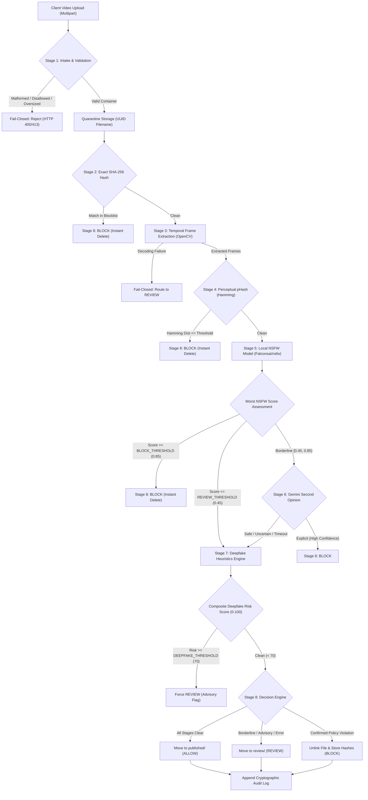
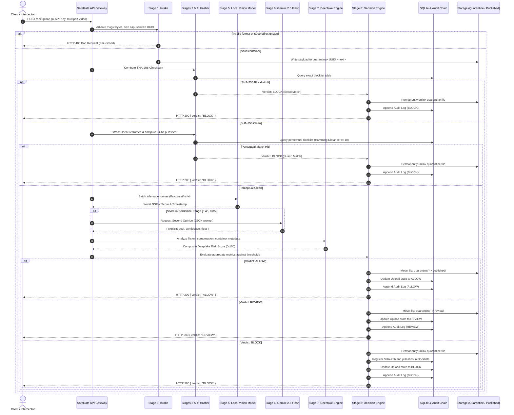

# SafeGate — Technical Architecture & Pipeline Specification

## 1. System Overview

**SafeGate** is a self-hosted, fail-closed AI upload gateway designed to screen digital video media for explicit (18+/pornographic) content and flag suspected synthetic/deepfake manipulation prior to publication.

In contrast to conventional asynchronous moderation pipelines that publish content optimistically and retroactively remove violations, SafeGate operates synchronously as a **fail-closed defensive security boundary**:
- Any pipeline error, unreadable container, model timeout, or ambiguous classification routes the file into a quarantined **REVIEW** queue.
- Confirmed prohibited media is **never stored**; it is destroyed immediately, and only its non-reversible cryptographic and perceptual fingerprints are indexed to prevent future re-uploads.
- All actions are chained into a **tamper-evident audit log** via SHA-256 hash chaining.

---

## 2. Architectural Flowcharts & Diagrams

### 2.1 Complete 8-Stage Pipeline Flowchart

---

### 2.2 Sequence Diagram: Upload Lifecycle & Gate Enforcement

---

## 3. Pipeline Stages Breakdown

| Stage | Name | Technology | Operational Function | Fail-Closed Policy |
|---|---|---|---|---|
| **1** | **Intake & Validation** | `filetype` / `python-magic`, `tempfile` | Validates file header magic bytes (rejects renamed `.exe` or polyglot files), checks byte size cap (default: 200 MB), strips client filenames, generates random 32-character hexadecimal UUID, writes atomically to `quarantine/`. | Rejects upload with HTTP 400/413 immediately. |
| **2** | **Exact Hash Blocklist** | SHA-256, SQLAlchemy | Computes raw payload cryptographic digest and performs $O(1)$ indexed lookup in `blocklist_hashes`. | Immediate BLOCK on hit; unlinks file instantly. |
| **3** | **Temporal Frame Extraction** | OpenCV (`cv2.VideoCapture`), PIL | Samples first frame (0.0s), last frame, and 1 frame every 2 seconds (`FRAME_INTERVAL_SEC`), normalized to $640 \times 480$. Capped at `MAX_FRAMES=60` to mitigate CPU denial-of-service. | Decoding failure or unreadable container routes upload to REVIEW. |
| **4** | **Perceptual Hashing** | Discrete Cosine Transform (DCT) `imagehash.phash` | Generates 64-bit pHash per frame. Computes Hamming bit distance against `blocklist_phashes`. | If Hamming distance $\le 10$ (`PHASH_HAMMING_THRESHOLD`), immediate BLOCK. |
| **5** | **Local NSFW Vision Model** | Hugging Face Transformers, PyTorch (`Falconsai/nsfw_image_detection`) | Offline ViT classifier scoring each extracted frame for nudity and explicit anatomy. Records maximum probability and corresponding timestamp. | Model load error, corrupted tensor, or missing weight file routes to REVIEW. |
| **6** | **Cloud Second Opinion** | Google GenAI SDK (`GEMINI_MODEL`, default `gemini-2.5-flash`) | Invoked strictly when worst local score falls in borderline band $[0.45, 0.85)$. Never called for clearly safe ($<0.45$) or clearly explicit ($\ge 0.85$) frames. Requests strict JSON rationale. | Safety refusals, rate limits, network timeouts, or malformed JSON default to "uncertain" (routes to REVIEW). |
| **7** | **Deepfake Heuristics Engine** | OpenCV, NumPy, FFmpeg/Metadata Inspection | Computes advisory risk score ($0-100$): 1. Face sharpness variance across frames (Laplacian variance). 2. Temporal frame flicker (color histogram Bhattacharyya distance). 3. High-frequency compression artifact inconsistencies. 4. Container metadata anomalies (e.g. `Lavf` encoder signatures, missing camera EXIF). | High score ($\ge 70$) **never auto-blocks**; forces REVIEW for human inspection. |
| **8** | **Unified Decision Engine** | Pure Python (`app/pipeline/decision.py`) | Synthesizes all detector signals against thresholds defined in `config.py`. Enforces physical storage isolation and updates the cryptographic audit log. | Any runtime exception or unhandled state defaults to REVIEW. |

---

## 4. Cryptographic Tamper-Evident Audit Chain

To prevent retrospective alteration of screening records or suppression of moderator actions, SafeGate maintains a sequential cryptographic hash chain:

$$\text{row\_hash}_i = \text{SHA256}(\text{row\_hash}_{i-1} \parallel \text{action} \parallel \text{details} \parallel \text{upload\_id} \parallel \text{created\_at})$$

- **Genesis Block ($i=0$)**: Uses an initial previous hash of 64 zeros: `"0" * 64`.
- **Integrity Verification**: `GET /api/audit/verify` re-computes hashes sequentially from row 1 to tip. If an attacker tampers with a record or deletes an intermediate row, the hash chain breaks at that exact ID, flagging the compromise immediately.
